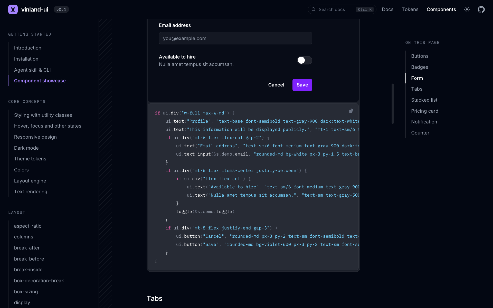

# vinland-ui

A utility-first UI framework for [Odin](https://odin-lang.org). Write UI in Odin, style it with
Tailwind CSS class names that resolve through design tokens, and let a small GPU renderer draw it
at your display's real pixel density.




```odin
if ui.div("flex items-center gap-4 rounded-xl bg-white p-6 shadow-lg ring-1 ring-gray-950/5 dark:bg-gray-900") {
    ui.icon(IC.sparkles, "size-6 text-violet-500")
    if ui.div() {
        ui.text("Ship it natively", "font-semibold text-gray-950 dark:text-white")
        ui.text("One binary, no webview, sharp text.", "text-sm text-gray-500")
    }
    if ui.button("Get started", "ml-auto rounded-lg bg-violet-600 px-3 py-2 text-sm font-semibold text-white hover:bg-violet-500") {
        start()
    }
}
```

## Why

Native Odin tools and games deserve UI that holds up next to a good web app. Most immediate-mode
UI libraries look "programmer art" because of two things: text and taste. vinland-ui fixes the
first in the renderer and hands the second to a vocabulary people already know.

- **Crisp text.** Glyphs are rasterized at the exact physical size (font size × display scale),
  positioned with 1/4-pixel precision and snapped to whole-pixel baselines. Windows use SDL3
  high-density mode, so fractional scales such as 1.25 or 1.333 render natively instead of being
  stretched by the compositor. Icons go through the same rasterizer.
- **Tailwind vocabulary.** `flex`, `gap-4`, `rounded-xl`, `shadow-lg`, `hover:bg-sky-600`,
  `dark:text-white`, `md:grid-cols-3`, `group-hover:`, `bg-linear-to-r from-violet-500 to-fuchsia-500`.
  The palette and scales are Tailwind CSS v4's.
- **Design tokens.** Every utility resolves through a `Theme` (colors, spacing, radii, shadows,
  type, breakpoints...). Tokens can carry light and dark values and can be loaded from JSON, so an
  app can be re-skinned without touching component code.
- **Unstyled core.** A `ui.div` is an empty box. Buttons, checkboxes, sliders and text inputs are
  behaviour only; every pixel comes from your classes.
- **Real layout.** Block flow, flexbox (grow/shrink/wrap/auto margins), grid (fr/px/auto tracks,
  spans), absolute/fixed positioning, scroll containers.
- **Agent-drivable.** Apps expose a local control port; `vui-ctl` clicks, types, scrolls, resizes,
  toggles dark mode, dumps the element tree and takes screenshots. An agent skill ships in
  [`skills/vinland-ui`](skills/vinland-ui/SKILL.md).

Inspired by Jetpack Compose (UI in the host language), Flutter (own the renderer), Quickshell
(small, animated desktop UI) and Tailwind CSS (the vocabulary).

## Quick start

Requirements: Odin `dev-2026-11` or newer, SDL3 development files, an OpenGL 3.3 driver.

```bash
git clone https://github.com/WilsonNet/vinland-ui
cd vinland-ui
./build.sh            # build/showroom, build/vui-ctl, build/hello
./build/showroom      # the documentation app
```

A first window:

```odin
package my_app

import ui "vinland:vui"
import "vinland:vui/app"
import "vinland:vui/fonts"

main :: proc() {
    ctx: ui.Context
    ui.init(&ctx)
    defer ui.destroy(&ctx)
    fonts.register(&ctx)

    a: app.App
    if !app.init(&a, {title = "Hello", size = {960, 640}, control_port = 7420}, &ctx) do return
    defer app.shutdown(&a)

    for app.next_frame(&a) {
        if ui.div("flex h-full items-center justify-center bg-white dark:bg-gray-950") {
            ui.text("Hello from Odin", "text-4xl font-semibold tracking-tight text-gray-950 dark:text-white")
        }
        app.end_frame(&a)
    }
}
```

```bash
odin build my_app -collection:vinland=path/to/vinland-ui
```

## The showroom

`showroom/` is the documentation: every Tailwind docs page (184 utility pages plus guides), each
with its class reference and, for everything the renderer draws, live examples whose code is the
real source cut from the showroom files. Search with Ctrl+K, toggle dark mode from the top bar.

## Driving an app from the terminal

```bash
VUI_HIDDEN=1 VUI_SCALE=2 ./build/showroom &      # offscreen, 2x
./build/vui-ctl nav page=box-shadow
./build/vui-ctl dark on
./build/vui-ctl screenshot shadow.png
./build/vui-ctl click-text "Show all"
./build/vui-ctl tree 6
```

See `vui-ctl --help` and the "Agent skill & CLI" page in the showroom.

## Layout of the repo

| Path | |
|---|---|
| `vui/` | core: tree builder, utility parser, tokens, layout, text, paint |
| `vui/app/` | SDL3 + OpenGL 3.3 host and control server |
| `vui/fonts/` | embedded Inter, IBM Plex Mono, Source Serif 4 (OFL) |
| `vui/icons/` | Heroicons (MIT) |
| `tools/vui-ctl/` | control CLI |
| `tools/gen/` | generators for the palette, icons and reference tables |
| `showroom/` | documentation app |
| `skills/vinland-ui/` | skill for coding agents |

## Status

Early (v0.1). Linux is the tested platform; the code avoids platform specifics (SDL3, GL 3.3) but
macOS and Windows are untested. Not yet rendered: blur and backdrop filters, blend modes, masks,
3D transforms, multi-font fallback for missing glyphs, complex-script shaping (Latin text with
kerning is supported). Unsupported utilities parse without errors and are listed by
`vui-ctl info` when unknown.

## License

MIT. Bundled fonts are under the SIL Open Font License; Heroicons and the Tailwind-derived palette
and scales are MIT. See [LICENSE](LICENSE).
